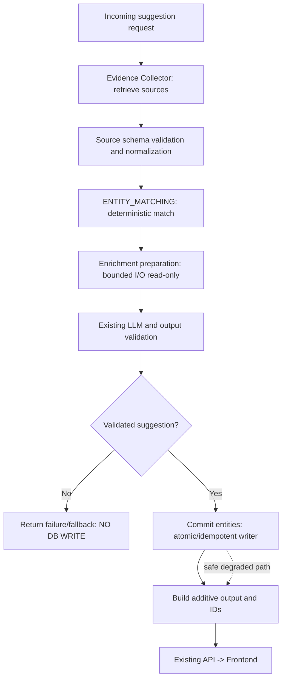

# AI Suggestion — Entity Enrichment
## Production-Grade Implementation Plan v2.0 · Gemini Antigravity

> **Dự án tham chiếu:** `D:\Project\ReactJS\sap-phim` — React frontend, Node.js/Express backend, PostgreSQL/Sequelize (theo `upgrade_plan.md`), Redis nếu đã được cấu hình.  
> **Trạng thái:** SPECIFICATION / NOT YET IMPLEMENTED. Kế hoạch này được biên soạn từ file người dùng cung cấp; không có quyền truy cập repository nên mọi tên field, đường dẫn và scripts phải được Agent kiểm chứng trước khi sửa.  
> **Phạm vi:** AI Suggestion Movie; Actor, Studio, Director; TMDB + AniList; không thay thế pipeline gốc.  
> **Ưu tiên:** bảo toàn dữ liệu > tính đúng đắn định danh > tương thích ngược > tính năng enrich > hiệu năng.

## 0. Mục tiêu, phạm vi và định nghĩa hoàn thành

### Mục tiêu chức năng (giữ 8 quyết định sản phẩm gốc)

1. Enrich dữ liệu Actor, Studio và Director từ **nguồn xác thực**, không để LLM tự bịa profile.
2. Auto-create Actor/Studio hợp lệ chưa tồn tại trong DB, đánh dấu `metadata.auto_created: true` và lưu định danh nguồn.
3. Live-action dùng TMDB Person; anime dùng AniList Staff **cho nhân sự**, AniList `characters.edges.voiceActors` **cho voice cast**. Có thể dùng TMDB cast nếu đó là nguồn phù hợp đã xác minh.
4. Enrich tối đa **10 Actor phân biệt/request** thuộc tập mới hoặc main cast, với danh sách ưu tiên nhất quán; director được tính trong ngân sách outbound riêng (xem §6).
5. Giữ nhãn pipeline stage `ENTITY_MATCHING`: không thêm stage public-facing. Có thể tách hoạt động nội bộ thành prepare/commit trong các điểm xử lý đang tồn tại.
6. Giữ `Movie.director: STRING(255)`; thêm additive `Movie.director_metadata: JSONB NOT NULL DEFAULT '{}'` **sau khi xác nhận dialect PostgreSQL, mapping tên bảng và cơ chế migration**.
7. Cache theo `{source,id}` với TTL dương **604800 giây (7 ngày)**.
8. Mở rộng `suggested_entities` cho frontend theo mô hình **additive**; giữ các khóa cũ đến khi consumer được migration.

### Không thuộc phạm vi

- Không đại tu toàn bộ schema Actor/Studio, không nhập vai trò/diễn viên từ dữ liệu LLM không có chứng cứ.
- Không thêm một service microservice hay một pipeline stage mới.
- Không thay đổi theme/style framework hoặc thay toàn bộ trang suggestion.
- Không tự động ghi đè các trường do admin quản lý ở bản ghi hiện có.
- Không làm migration DB production hay cập nhật production trực tiếp khi chưa có backup/phê duyệt vận hành.

### Definition of Done

- Có bảng kết quả khảo sát repository và mọi giả định được giải quyết hoặc gắn `BLOCKED`.
- Migration up/down được thử trên DB thử nghiệm, không gây mất dữ liệu cũ.
- Enrich đúng TMDB/AniList và không suy đoán field thiếu; kết quả nhất quán, có nguồn.
- Auto-create idempotent dưới concurrent requests; không nhân đôi bản ghi dù gọi lại cùng suggestion.
- Không ghi rác khi validation, timeout, hủy yêu cầu hoặc pipeline thất bại.
- Kết quả hiện có và UI cũ tiếp tục hoạt động; UI mới hiển thị Actor, Studio, Director và trạng thái chưa xác minh.
- Unit, integration, API contract, frontend, migration, failure-injection tests thành công hoặc có báo cáo blocker cụ thể.
- Feature flags cho phép tắt enrich và write-back độc lập; có kiểm chứng rollback.

## 1. Audit các lỗi của kế hoạch v1 và quyết định khắc phục

| ID | Severity | Vấn đề | Thiết kế v2 |
|---|---|---|---|
| A01 | P0 | Nói “giữ schema DB” nhưng thêm column | Định nghĩa rõ giữ model Actor/Studio nếu tương thích; **Movie có 1 thay đổi schema additive**; index bổ sung chỉ sau audit |
| A02 | P0 | Match/create ở Matcher và Pipeline cùng thực hiện | `EntityMatcher` sở hữu prepare/match; **một `EntityPersistence` hoặc hàm matcher commit** là writer duy nhất; Pipeline chỉ orchestration |
| A03 | P0 | Auto-create trước khi xác thực thành công dẫn đến bản ghi mồ côi | Tách `prepareEnrichment()` read-only và `commitEntities()` sau validation thành công, trước return; stage public vẫn `ENTITY_MATCHING` |
| A04 | P0 | Lowercase/slug không ngăn race hoặc người trùng tên | Identity `(source, external_id)`, DB uniqueness/atomic upsert, conflict resolution, advisory lock khi phù hợp |
| A05 | P0 | AniList production staff khác voice cast | Voice cast lấy qua `Media.characters.edges.voiceActors`; director tìm ở `Media.staff.edges.role` |
| A06 | P1 | `isAnimation = anilist != null` suy luận sai | Quyết định source per-entry từ evidence loại media/credit relationship đã xác thực |
| A07 | P1 | TMDB Person/AniList Staff không cung cấp nationality chuẩn | Không suy đoán từ place_of_birth/homeTown/language; `nationality: null` nếu chưa có nguồn hợp lệ |
| A08 | P1 | AniList birth date có thể khuyết ngày/tháng | Lưu date đầy đủ nếu đủ và hợp lệ; nếu không chỉ giữ source partial date trong metadata nếu schema cho phép |
| A09 | P1 | Director có thể >1, anime roles không thuần 'Director' | Phân loại theo source role, lưu danh sách; `director` string legacy tuân theo quy tắc repo |
| A10 | P1 | Studio chỉ tạo theo tên bất kỳ | Chỉ auto-create khi có verified TMDB production_company ID hoặc AniList studio ID; tên-only hiển thị `needs_review` |
| A11 | P1 | `is_new=false` sau create làm mất ngữ nghĩa | Tách `match_status`, `auto_created_in_request`, `is_new` legacy có tài liệu mapping |
| A12 | P1 | Lấy 10 actor trong v1 nhưng director phát sinh request thứ 11 | Cấu hình ngân sách: 10 distinct actor IDs + tối đa 1 director ID, mỗi nguồn có giới hạn đồng thời |
| A13 | P1 | Promise.allSettled không phải throttling | Dùng queue/p-limit tương đương, global provider limiter nếu hệ thống đã có |
| A14 | P1 | Cache chỉ chia source/id, không quản lý localization/schema | Dùng `ai:v2:person:{source}:{id}:{locale}` với positive 7 ngày và negative cache ngắn; `ai:v1...` chỉ dùng khi tương thích |
| A15 | P1 | Schema output mới bỏ khóa cũ | Additive response, `schema_version: 2`, adapter ở UI và contract tests |
| A16 | P1 | Validator v1 gắn với output LLM | Validate dữ liệu nguồn và merged output độc lập; không đưa metadata bên ngoài cho LLM viết lại |
| A17 | P1 | Thiếu abort, retry và timeout | Propagate AbortSignal, retry có điều kiện và giới hạn, fail-open có trạng thái |
| A18 | P1 | Không có rollout, monitoring và test | Phase riêng cho test, observability, gradual rollout, rollback |
| A19 | P2 | File list thiếu frontend API consumer, migrations thực tế | Agent tìm callsites bằng search và lập inventory trước khi code |
| A20 | P2 | Ước tính 7 giờ chưa tính concurrency/migration/tests | Thay bằng range theo công việc và kết quả audit, không dùng estimate để ép bỏ test |

## 2. Repository reconnaissance bắt buộc (Phase 0)

Agent PHẢI đọc code thật trước khi edit, ghi kết quả vào `ENTITY_ENRICHMENT_REPO_AUDIT.md` (tại docs/plans nếu repo có convention). Danh mục bắt buộc:

1. `package.json`, workspace scripts, lockfile, Node version, ESLint/Prettier, test runner.
2. `apps/server/src/models/movie.model.js`, Actor/Studio models, relations, association tables, migrations và unique indexes hiện có.
3. `evidence-collector.service.js`, `entity-matcher.service.js`, `ai-pipeline.service.js`, `ai.constants.js`, `evidence-fields.util.js`, `movie-suggestion.prompt.js`, `ai-output.validator.js`.
4. Controller/routes, auth/permission, API response serializer, cache abstraction, Redis connection, rate limiter, retry helper, centralized error handler.
5. Frontend components/hooks/services sử dụng `suggested_entities`, `studio_name`, `actor_names`, `director`, `director_metadata`, `actor_id` và phần save/approve/edit suggestion.
6. DB current columns: Actor `name`, `slug`, `gender`, `birth_date`, `nationality`, `biography`, `aliases`, `image_url`, `metadata`; Studio `logo_url`, `country`, `metadata`; Movie `director`; nullable/validators/unique constraints.
7. Tác dụng phụ của pipeline: `suggest` là read-only hay vừa suggest vừa persist? Có draft/session/approval transaction? Nơi xác nhận kết quả cuối và lỗi trả về.
8. Quy định Global/Workspace Rules, deployment policy, secrets, environment configs, feature flags, migrations commands.
9. Xác định TMDB `movie/credits` hay `tv/*/credits` đang được sử dụng và shape AniList snapshot (`characters`, `staff`, `studios`).
10. Những field/endpoint được gọi bởi external integration không do repo kiểm soát.

**Gate P0:** nếu Actor/Studio thiếu `metadata` hoặc không có cách enforce unique identity, **không tiến hành destructive DB writes**. Báo rõ phương án A: bổ sung JSONB/index theo migration được phê duyệt; hoặc B: chỉ enrich + trả kết quả `needs_review` và disable auto-create cho entity chưa an toàn. Không giả vờ hoàn thành auto-create.

## 3. Kiến trúc giải pháp và ranh giới trách nhiệm



**Vai trò:**
- **Evidence Collector:** lấy TMDB/AniList + cache và chuẩn hóa person/studio credits; không trực tiếp insert DB.
- **Entity Matcher:** candidate selection, match DB, identity confidence, format `PreparedEntity`; không gọi `create` trùng ở Pipeline.
- **Entity Persistence:** *một* boundary DB transaction/upsert, chạy sau validation. Có thể đặt trong service matcher có sẵn nếu không muốn sinh thêm file.
- **AI Pipeline:** gọi các service đúng thứ tự và tạo response; không tự `Actor.create` hoặc `Studio.create`.
- **Validator:** phân biệt validation evidence, LLM payload và public response; kiểm tra ID, length, safe URL, nullable fields.
- **Frontend:** render trạng thái `existing | created | suggested_unverified` bằng adapter, không tự ghi vào backend khi render.

**Không thêm stage mới:** prepare là tiểu bước trong `ENTITY_MATCHING`; commit là operation hoàn tất entity result sau successful LLM validation. Nếu pipeline có state machine nghiêm ngặt, hãy giữ tên stage chính và đặt operation trong đoạn finalization hiện hữu, có test thứ tự và không thay API stage enumeration.

### 3.1 Canonical source identity

- Person: `tmdb:person:<positive-id>` hoặc `anilist:staff:<positive-id>`.
- Studio: `tmdb:company:<positive-id>` hoặc `anilist:studio:<positive-id>`.
- Movie/source identity: phân biệt `tmdb:movie:<id>`, `tmdb:tv:<id>`, `anilist:anime:<id>`; không join tùy tiện theo tên.
- Mỗi `credit` phải gắn vào phim/series nguồn đã match title + type + release context, không nhận name/ID do LLM sinh tùy ý.
- Một người có thể có nhiều source IDs; không được tự động gộp hai bản ghi khác nguồn chỉ vì tên bằng nhau. Cross-source merge chỉ nếu có verified external linking hoặc admin approval.
- `slug` là URL display key, **không phải identity key**; cùng tên có thể khác người. Nếu slug đã có và identity khác, tạo slug deterministic từ source+ID theo conventions của repo.

### 3.2 Quy tắc matching độ tin cậy

1. Exact `(source,id)` đã gắn với entity hiện có -> `existing/verified`.
2. Định danh nguồn có liên kết xác minh đến bản ghi DB -> `existing/verified`.
3. Name/alias match mà không có nguồn ID chung -> candidate (không auto-merge nếu ambiguous).
4. Source ID có thật, thuộc verified movie/credit, không match DB -> `new/eligible_to_create`.
5. Name-only, thiếu source ID hoặc source credit -> `suggested_unverified`, **không auto-create**.
6. Conflicting IDs, nhiều match hoặc tên nguồn không khớp rõ ràng -> `ambiguous`, report admin review.

### 3.3 Writer, transactions và concurrent safety

`commitEntities(prepared, { transaction, signal })`:

- Input validated, deterministic, dedupe `(entity_kind, source, source_id)` trong request; không nhận raw LLM object.
- Ghi DB sau source/LLM output valid, trước trả response thành công.
- Đối với mỗi identity: lock/atomic upsert với unique index tại DB (khuyến nghị). Catch unique violation, re-select và trả ID sẵn có.
- Nếu metadata JSONB hiện hữu, dùng `metadata.source`, `metadata.source_id`, `metadata.auto_created`; nếu hệ thống đã có `external_ids` thì ưu tiên reuse contract hiện có, tránh song song hai nguồn chân lý.
- Migration index duy nhất cần thiết phải kiểm tra trước **duplicates hiện hữu**, xử lý qua kế hoạch hợp nhất/manual; không được tự xóa/trộn bản ghi.
- Transaction chỉ bọc thao tác DB nhỏ; **không** giữ transaction khi gọi API, cache hoặc LLM.
- Không overwrite manual (`auto_created: false`/admin edited) fields bằng enrichment. Update vào empty fields hoặc theo field-level ownership policy có audit trail.
- Khi batch có một item lỗi DB, default fallback: không tạo item lỗi; giữ remaining successful IDs nếu transactional per item và đủ rõ nghĩa; chọn transaction batch atomic nếu repo require all-or-nothing; phải ghi rõ quyết định vào audit và test.
- Nếu yêu cầu bị abort trước commit -> no write; nếu abort trong commit, rollback nếu an toàn; không hứa 'no write' sau khi transaction đã commit.
- Không phát sinh Movie save, associations/pivot hay gửi notifications trong việc preview nếu repo chưa có quy định rõ. Các entity tạo từ **validated nhưng chưa được người dùng chấp nhận** có thể tồn tại chưa liên kết; đây là hệ quả của quyết định auto-create-on-suggestion và cần audit/report + quy trình review hoặc retention theo chính sách dự án, không tự động xóa.

### 3.4 Quy tắc Studio

- Nguồn live-action: verified `production_companies[]` từ TMDB movie/TV details (không phải tên AI-generated).
- Nguồn anime: AniList `Media.studios.edges { node { id name isAnimationStudio } isMain }`; ưu tiên main studio phù hợp model một-studio hiện tại; các studio phụ giữ trong suggestions nếu contract cho phép.
- Logo và country chỉ khi source cung cấp và đủ xác thực; AniList Studio không bảo đảm logo/country.
- Nếu repo không có relationship multi-studio, **không** thêm bảng liên kết ngoài phạm vi; phản ánh các studio phụ trong output mà không tự gán vào 1 FK duy nhất.

## 4. Nguồn API và chuẩn hóa dữ liệu (Phase 1)

### 4.1 TMDB Person

Endpoint: `GET /3/person/{person_id}?language=vi-VN` (reuse API client/auth/timeout hiện có). Fields cần xử lý **nếu API có trả**:

`id, name, also_known_as, gender, birthday, place_of_birth, biography, profile_path, known_for_department`.

- `gender` TMDB: `0 = unspecified`, `1 = female`, `2 = male`, `3 = non-binary`; normalize theo enum DB thực tế (không hard-code numeric vào database nếu model là string).
- `profile_path` chỉ là file path; tạo URL bằng cấu hình base + size + path từ TMDB image API. Không nối URL tùy tiện, tránh remote URL injection.
- Biography locale `vi-VN` có thể rỗng: cân nhắc fallback `en-US` **chỉ khi** còn outbound budget và cần; không lấy empty string ghi đè nội dung hiện hữu.
- `place_of_birth` không phải quốc tịch: `nationality = null` nếu không có xác minh khác.
- Không lấy `known_for_department` thay cho `crew.job` để suy diễn đạo diễn của *tác phẩm này*.
- Dùng đúng credits namespace của tác phẩm (`movie` vs `tv`), lấy source ID từ credits gốc.

### 4.2 AniList Staff (person details)

GraphQL (xác nhận schema thực tế khi implement):

```graphql
query StaffById($id: Int) {
  Staff(id: $id) {
    id
    name { full native alternative userPreferred }
    image { large medium }
    description(asHtml: false)
    gender
    dateOfBirth { year month day }
    homeTown
    primaryOccupations
    languageV2
    siteUrl
  }
}
```

- `description(asHtml: false)` là text/markup nguồn ngoài, sanitize và render an toàn.
- `dateOfBirth` là FuzzyDate; chỉ convert sang DATE khi đủ year/month/day hợp lệ. Không tự tạo ngày 01/01.
- `homeTown` không thể hiện quốc tịch; `languageV2` là language, **không phải** nationality.
- AniList Staff có thể là actor hoặc production staff; danh sách **voice actor** phải đi từ quan hệ Character↔VoiceActor của *đúng anime*, không từ Media.staff.

### 4.3 AniList Media anime edges

```graphql
query AnimeCredits($id: Int) {
  Media(id: $id, type: ANIME) {
    id
    characters(page: 1, perPage: 25) {
      edges {
        role
        node { id name { full userPreferred } }
        voiceActors { id name { full userPreferred } languageV2 image { large } }
      }
    }
    staff(page: 1, perPage: 25) {
      edges { role node { id name { full userPreferred } } }
    }
    studios { edges { isMain node { id name isAnimationStudio } } }
  }
}
```

- Dùng quan hệ character edge để xác định `character_name` và cast role (`MAIN`, `SUPPORTING`, `BACKGROUND` theo schema thực tế).
- Một character có thể có nhiều voice actors (ngôn ngữ khác nhau); phải có lựa chọn ngôn ngữ mặc định rõ ràng, ví dụ Japanese nếu present và phù hợp dataset; nếu không có thì giữ thông tin ngôn ngữ + chọn deterministic theo policy repo, không lẫn các dub.
- Nếu pagination thực tế vượt 25, xử lý paging tối đa theo budget và chỉ fetch trang cần đủ 10 distinct verified actors; không assume lấy 25 là đầy đủ.
- Chỉ đánh dấu director với staff role xác thực `Director` / `Chief Director` theo rule rõ; các vai trò `Episode Director`, `Animation Director`, `Art Director` không tự động coi là đạo diễn toàn series.
- Chỉ dùng `studio.isAnimationStudio` khi có trường/nguồn hỗ trợ; `isMain` là thuộc edge anime-studio.

### 4.4 Không tùy tiện suy diễn

| Target | TMDB | AniList | Nếu nguồn thiếu |
|---|---|---|---|
| `name` | Person.name | Staff.name.full/userPreferred | Bỏ qua create nếu không hợp lệ |
| `source_id` | Person.id | Staff.id | Bắt buộc cho auto-create |
| `aliases` | also_known_as | name.alternative, native | `[]` |
| `image_url` | profile_path qua TMDB images | image.large/medium | `null` |
| `gender` | enum 0..3 | string open-ended | `null`/unspecified |
| `birth_date` | birthday ISO validated | FuzzyDate only when complete | `null` |
| `nationality` | KHÔNG từ place_of_birth | KHÔNG từ homeTown/languageV2 | `null` |
| `biography` | biography (localized) | description sanitized | `null` |
| `character_name` | cast.character | CharacterEdge.node.name | `null` nếu thiếu |
| `role` | cast order / billing (repo logic) | CharacterEdge.role | preserve verified classification |

## 5. Director contract (Phase 2)

- Không thay đổi semantics và type của `Movie.director`. Đối với nhiều đạo diễn, giữ định dạng legacy hiện tại (nếu repo lưu danh sách qua chuỗi, follow parser đang dùng); kiểm tra giới hạn `255` ký tự; không cắt ngang tên mà không thông báo.
- `director_metadata` chứa `schema_version`, `primary` và `people[]`, kèm nguồn/provenance, nếu lưu danh sách được UI cần dùng; chỉ viết đúng các field được Movie model hỗ trợ hoặc JSONB cho phép.
- `primary` dựa vào tín hiệu đạo diễn chính đã xác minh và priority deterministic. Nếu có nhiều director đồng cấp, chọn stable ordering và giữ tất cả ở `people[]`.
- TMDB: crew credit với `job === 'Director'` (hoặc policy tương ứng với TV creator/episode, **không** nhầm `created_by` với film director).
- AniList: `Media.staff.edges.role`, filter theo allowlist role chính đã xác minh; không coi mọi `staffRole` là director.
- Director person enrichment dùng cùng cache normalization; person có thể đồng thời nằm trong cast, phải dedupe provider request.
- Không để LLM tạo/làm giàu `director_metadata` độc lập với evidence; trường mới được assembled bởi deterministic enrichment layer.

Ví dụ JSONB (minh họa, không phải schema DB đã được xác nhận):

```json
{
  "schema_version": 1,
  "primary": "tmdb:person:42",
  "people": [
    {
      "source": "tmdb",
      "source_id": "42",
      "name": "Example Director",
      "credit_role": "Director",
      "image_url": null,
      "nationality": null,
      "biography": null
    }
  ]
}
```

Nếu `director_metadata` của Movie chỉ được lưu **khi save movie**, suggestion phải expose field tạm đúng hợp đồng; không insert/update Movie từ request preview.

## 6. Throttling, caching, failure management (Phase 3)

### Cache

- TTL positive: `AI_CACHE_TTL.PERSON_ENRICHMENT_SECONDS = 604800`.
- Cache key khuyến nghị `ai:v2:person:{source}:{id}:{locale}` (`locale` default `vi-VN` với TMDB, `default` AniList); `v2` tránh đọc nhầm shape cache v1 khi đổi normalized payload.
- Cache entry phải có version, source, ID, fetchedAt, normalized data; validate khi deserialize; TTL thuộc cache service hiện có.
- 404/không có ID: optional negative cache ngắn khoảng 5–15 phút và không cache timeout, 429, 5xx như kết quả “không tồn tại”.
- Redis lỗi -> graceful fallback; không khiến toàn pipeline fail nếu enrichment là optional.
- `forceRefresh` có auth + rate limit; bust cache theo đúng provider person identity, không nhận key tùy ý từ người dùng.

### Quota và tính ưu tiên

- Tối đa **10 distinct actor identities** cần enrich/request (gồm newly discovered hoặc main cast); dedupe ID trước khi tính.
- Priority: (1) main cast mới, (2) main cast đã có nhưng thiếu data, (3) actor mới supporting theo source billing/order, (4) còn lại; stable tie-break source order+ID.
- Director tối đa **1 distinct person detail outbound call/request** theo default, ưu tiên cache reuse; nếu co-director >1 chỉ detail người còn lại khi đã có cache/credits hoặc theo follow-up không ảnh hưởng baseline. Có thể thay bằng configurable director budget nếu yêu cầu business khác.
- `maxConcurrency` mặc định đề xuất 3 per request/provider, nhưng **audit** rate-limit existing, upstream quotas và traffic trước khi chọn con số thật.
- Timeout mỗi outbound request và cả enrichment batch từ config; AbortSignal theo request gốc; không dùng `Promise.all()` không giới hạn.
- Retry với 429/5xx/network transient có backoff và Retry-After + jitter nếu helper hiện có hỗ trợ. Không retry 400/401/403/404. Không đặt retry vô hạn.
- `Promise.allSettled` kết hợp bounded concurrency và deterministic order; actor fail trả data credit tối thiểu, `enrichment_status: 'failed'`, không biến missing thành false facts.
- P95 latency và rate of errors xác lập từ baseline đo thực tế, không tự tuyên bố đạt khi chưa benchmark.

### Lỗi / response

- Result successful but optional enrichment failed -> HTTP semantics hiện tại giữ nguyên, có `warnings[]` (nếu API contract cho phép) và trạng thái granular.
- Identity conflict/database uniqueness race -> re-select exact source identity; lỗi không xử lý được -> `suggested_unverified`, không tạo đại một Actor name-matched.
- LLM/validator thất bại -> không auto-create; không mutation ngoài luồng.
- Unauthorized request -> không write; existing auth path không bị bypass.

## 7. Response contract v2 và backward compatibility (Phase 4)

### Ví dụ normalized response (tên/ID placeholder)

```json
{
  "director": "Example Director",
  "director_metadata": {
    "schema_version": 1,
    "primary": "tmdb:person:42",
    "people": [{ "source": "tmdb", "source_id": "42", "name": "Example Director", "credit_role": "Director" }]
  },
  "suggested_entities": {
    "schema_version": 2,
    "studio_name": "Example Studio",
    "country_name": null,
    "actor_names": ["Example Actor"],
    "studio": {
      "id": 101,
      "name": "Example Studio",
      "logo_url": null,
      "country": null,
      "source": "anilist",
      "source_id": "900",
      "match_status": "created",
      "auto_created_in_request": true,
      "is_new": true
    },
    "director": {
      "name": "Example Director",
      "metadata": { "schema_version": 1, "primary": "tmdb:person:42", "people": [{ "source": "tmdb", "source_id": "42", "name": "Example Director", "credit_role": "Director" }] }
    },
    "actors": [
      {
        "actor_id": 201,
        "actor_name": "Example Actor",
        "actor_image_url": null,
        "character_name": "Example Character",
        "role_name": "MAIN",
        "is_main_cast": true,
        "is_new": true,
        "match_status": "created",
        "auto_created_in_request": true,
        "source": "anilist",
        "source_id": "200",
        "gender": null,
        "birth_date": null,
        "nationality": null,
        "biography": null,
        "enrichment_status": "enriched"
      }
    ]
  }
}
```

**Lưu ý:** JSON là example contract, `id`/`actor_id` type phải theo model thật. `director_metadata.people` phải khớp kết quả thật và dữ liệu nested director metadata phải được tạo từ một canonical object, không ráp chắp khác nhau. Nếu response không thể thêm `schema_version` vì schema strict, sử dụng additive shape đã được test và version thông qua API layer.

**Legacy fields:** giữ `studio_name`, `country_name`, `actor_names`, existing `director` và các dữ liệu gốc cho đến khi migrate mọi consumer. `is_new` là field tương thích ngược: **không thay đổi ngữ nghĩa hiện hữu** trước khi Agent kiểm tra tất cả consumer. Nếu contract legacy chưa rõ, giữ cách tính hiện tại và thêm `match_status` (`existing | created | suggested_unverified | ambiguous`) cùng `auto_created_in_request` để mô tả kết quả thực, tránh dùng `is_new=false` làm mất provenance. Các ví dụ `is_new` trong tài liệu mang tính minh họa, cần điều chỉnh theo kết quả repo audit.

**Frontend requirements:**
- Actor card: ảnh fallback, tên, vai diễn, badge source/match status nhẹ nhàng, truncated biography + expand, không giả lập dữ liệu rỗng.
- Studio: chỉ hiển thị logo/country khi có nguồn hợp lệ; khi chưa xác thực có nhãn chờ duyệt.
- Director: hỗ trợ một hoặc nhiều người, giữ `director` string khi save, metadata preview optional.
- Empty/loading/error/partial success rõ ràng; accessibility keyboard/focus/alt text; không HTML injection từ biography.
- Save/approval actions dùng ID đã persist, không create lại Actor/Studio; downstream FK/pivots kiểm tra.
- UI tuân thủ conventions của repo, kể cả Global Aesthetic OS rules nếu thực sự đã được cài trong workspace; không cài framework CSS mới.

## 8. Triển khai theo phase: dependency, file ownership, exit gates

> Agent kiểm tra đường dẫn thật. Dưới đây là các file từ tài liệu gốc, không phải xác nhận chúng đang tồn tại.

| Phase | File/area dự kiến | Việc thực hiện | Exit gate |
|---|---|---|---|
| **0** | models, services, migrations, frontend, tests | Repository audit + inventory callsites/schema/flags | Audit report và blockers được ghi rõ |
| **1** | `evidence-collector.service.js`, API client | Chuẩn hóa TMDB Person, AniList Staff, anime CharacterEdge voice actors, studio credits, nguồn | Fixture tests 3 nguồn và null/partial |
| **2** | `entity-matcher.service.js` | Match verified source IDs; xử lý multi roles, ambiguous matches, prepare read-only | No DB writes during prepare; deterministic ordering |
| **3** | `ai.constants.js`, cache/provider helpers | TTL 7d, scoped cache key, concurrency limit, abort, fallback, retry | Unit tests cache/cancel/rate limit |
| **4** | `movie.model.js`, migration & Actor/Studio constraints | Add `director_metadata`; conflict-safe identity storage/index nếu cần và được duyệt | up/down trên test DB, duplicate preflight |
| **5** | `entity-matcher.service.js` hoặc persistence helper, `ai-pipeline.service.js` | Một writer, transaction/upsert, commit sau validator, no duplicate orchestration | Idempotence/race/failure tests |
| **6** | `ai-output.validator.js`, response serializer, `evidence-fields.util.js`, prompt | Validate merge output, director metadata ngoài LLM, backward-compatible contract | API contract snapshots pass |
| **7** | frontend services/components/hooks | Render enrich, loading/fallback, director/studio/actor info, avoid double save | UI and integration tests pass |
| **8** | tests/fixtures/telemetry/config/docs | E2E, perf baseline, flags, canary, rollback, reporting | Definition of Done signed off |

### Chi tiết theo file gốc

**`movie.model.js`:** chỉ thêm `director_metadata` và mapping theo style Sequelize hiện tại; migration default `'{}'::jsonb`, nullable policy phù hợp. Kiểm tra DB table plural/case và timestamps/transaction. Nếu deployed, dùng expand-first.

**`evidence-collector.service.js`:** methods `fetchTMDBPerson`, `fetchAniListStaff`, `enrichActorDetails`, `enrichDirectorDetails` hoặc tái sử dụng provider client hiện có; nhất quán result types, error handling, cache, API key secrets.

**`entity-matcher.service.js`:** `matchActors`, `matchStudio`, `enrichDirector` chỉ đọc/prepare; create là service/hàm writer duy nhất sau validator. Giữ naming convention hiện có; không tạo vòng lặp gọi enrich từ cả matcher và pipeline.

**`ai-pipeline.service.js`:** orchestration `collectEvidence → match/prepare → LLM → validate → commit → serialize`; truyền AbortSignal và tracing; copy-safe data, không mutate snapshot gốc; không n+1 queries.

**`evidence-fields.util.js` & `movie-suggestion.prompt.js`:** giữ unchanged nếu LLM không cần `director_metadata`; không bắt AI “invent” information. Thêm `TRACKED_FIELDS` chỉ khi thực sự cần evidence-based diffs trong flow thực.

**`ai-output.validator.js`:** validate value types/status/length và output shape; sanitize biography/html ở boundary; từ chối unsupported URLs/script injection, duplicate actor identities, foreign IDs; preserve nulls.

**New tests:** đặt tại test directories/conventions hiện tại, không tự tạo hệ test thứ hai.

## 9. Test specification (Phase 8, bắt buộc)

### Unit tests

- TMDB genders 0/1/2/3 và unknown; birthday valid/invalid; missing profile/biography.
- AniList birth fuzzy partial; long markup sanitized; `languageV2` không thành nationality; voiceActors mapping correct; main/support priority; dub collision.
- TMDB credit director vs cinematography; AniList Director vs Episode Director; multi-director handling.
- Identity same name/different ID; same ID/different name; alias; accents; Unicode; slug collision.
- Cache hit/miss, Redis unavailable, 404 negative cache, timeout/429/5xx, refresh, stale cache, abort.
- Enrich selection: 0,1,10,11+ identities; main cast and newly discovered ranking; deterministic order.
- Output validator allows null; enforces no XSS, no prototype pollution in untrusted data.

### Integration tests

- **Two concurrent requests for same Actor source-ID:** exactly one DB Actor row and both results reference same ID.
- **Two different source IDs with identical display names:** two distinct entities or explicit human review; no false merge.
- Studio same tests + existing studio from manual entry not overwritten.
- Invalid LLM output after source enrichment: zero new entity writes.
- Request cancelled before commit: zero writes; retry yields same record.
- Failure mid DB transaction: rollback or per-entity outcome aligned documented atomicity policy.
- Original Movie rows and director values unchanged after migration.
- Save suggestion: no duplicate create; association created once; legacy consumers still pass.
- Feature flag off: exact legacy behavior for responses/write side effects.

### E2E / client tests

- Existing live-action film; new live-action actor; anime main Japanese voice actor; anime staff director; unknown person and unknown studio.
- Director multiple; no director found; missing images; frontend error/fallback; enriched suggestions partial.
- Keyboard navigation, screen-reader labels, XSS-sanitization, Unicode Vietnamese/Japanese names.

### Release gates

- Tests, lint/typecheck/build in CI (nếu repo có) phải pass; không báo "passed" nếu chưa chạy.
- Một thử nghiệm concurrency thật trên test DB và một smoke test với mocked upstream.
- Migration rollback được thử trên DB thử nghiệm có sample data, báo nếu down có thể mất metadata.
- Backend API response validated against old and v2 consumer schema.
- So sánh enrichment latency (p50/p95) và API failure rate trước/sau; định nghĩa threshold từ baseline và approval thay vì đặt SLA bừa.

## 10. Telemetry, feature flags, release và rollback

### Flags (tên đề xuất, kiểm tra config hiện có)

```text
AI_ENTITY_ENRICHMENT_ENABLED=false
AI_ENTITY_AUTOCREATE_ENABLED=false
AI_ENTITY_ENRICHMENT_ACTOR_LIMIT=10
AI_ENTITY_ENRICHMENT_DIRECTOR_LIMIT=1
AI_ENTITY_ENRICHMENT_MAX_CONCURRENCY=3
```

Production rollout: (1) ship additive schema and read-only enrichment **flags off**; (2) enable read-only for internal/canary; (3) enable auto-create cho xác định source ID theo tỷ lệ canary; (4) monitor duplicates/error/latency/DB row changes; (5) rollout rộng sau QA approval. Không tự đặt flag=true trong production secrets.

Telemetry không log secret, biography nguyên văn hoặc thông tin cá nhân không cần thiết. Event names đề xuất:

- `entity_enrichment_attempt_total{source,type,outcome}`
- `entity_enrichment_cache_hit_total{source}`
- `entity_match_ambiguous_total{entity_type}`
- `entity_auto_create_total{entity_type,result}`
- `entity_enrichment_duration_ms{source,type}`

Nếu hiện tại repo không có metrics framework, tích hợp vào logger/telemetry abstraction đang tồn tại, không tạo hệ thống logging riêng.

Rollback: tắt `AI_ENTITY_AUTOCREATE_ENABLED` trước, sau đó tắt enrich; giữ `director_metadata` column additive để old code vẫn chạy. **Không tự động xóa rows mới/đảo ngược migration down trong production**, vì có thể đã phát sinh references. Restore dữ liệu chỉ theo approved operations/runbook.

## 11. Migrations & database constraints (condition-based)

### 11.1 Mandatory additive migration

SQL minh họa **chỉ nếu** PostgreSQL schema/table đúng như kế hoạch gốc:

```sql
ALTER TABLE movies
  ADD COLUMN IF NOT EXISTS director_metadata JSONB NOT NULL DEFAULT '{}'::jsonb;
```

Trong Sequelize migration thực tế phải dùng queryInterface + transaction nếu deployment cho phép, chọn migration ID theo repo. Migration `down` drop column chỉ cho dev/test và có bảo vệ production. Kiểm tra index/row size/serialization.

### 11.2 Constraint cho Actor/Studio auto-created (không tự ý áp dụng)

- Kiểm tra `metadata` là JSONB, hiện có format `source_id` hoặc `external_ids`, slug uniqueness và những dữ liệu legacy duplicate.
- Ưu tiên existing `source`/`external_id` columns với unique composite index nếu repo đã có.
- Nếu chỉ `metadata` JSONB, cân nhắc **partial unique expression index** `(metadata->>'source', metadata->>'source_id')` cho các values hợp lệ — nhưng phải xác nhận support và tránh làm sai manual rows. Unique index này chỉ đảm bảo identity nếu **mọi writer cùng tuân thủ**.
- Không dùng `findOrCreate` đơn thuần để chứng minh concurrency-safety khi thiếu DB unique constraint.
- Không dùng slug uniqueness để ép gộp người trùng tên.
- Nếu bảo toàn schema Actor/Studio là ràng buộc tuyệt đối, báo rõ rằng guarantee auto-create concurrent không thể có nếu thiếu uniqueness/transaction mechanism tương đương; yêu cầu quyết định kỹ thuật trước production.

## 12. Pseudocode (illustrative — NOT copy/paste without repo audit)

```js
async function runSuggestion(input, { signal, actorLimit = 10 }) {
  const evidence = await collector.collect(input, { signal });
  const verifiedCredits = validateAndNormalizeEvidence(evidence);
  const prepared = await matcher.prepareRelationships(verifiedCredits, {
    signal,
    actorLimit,
    autoCreate: false, // no writes during prepare
  });

  const rawSuggestion = await llm.createSuggestion(prepared, { signal });
  const validated = validator.validateSuggestion(rawSuggestion, prepared);
  if (!validated.ok) return existingFailurePath(validated);

  let committed = prepared; // flags off => preserve legacy read-only behavior
  if (config.enrichmentAutoCreateEnabled) {
    committed = await entityPersistence.commitVerifiedEntities(prepared, { signal });
  }

  return serializer.toApiResponse(validated.data, committed, {
    preserveLegacyFields: true,
    schemaVersion: 2,
  });
}
```

**Chỉ dẫn bắt buộc:** Agent phải dựng đúng API/function tên đang có thay vì tạo API mới mà không cập nhật tất cả callsites; nếu public suggestion pipeline vốn tạo entity trước LLM vì nghiệp vụ, hãy mô tả lệch pha và áp dụng atomic finalization phù hợp mà không làm sai semantics.

## 13. Ma trận đánh giá rủi ro và ưu tiên sửa

| Risk | Likelihood | Impact | Prevention | Detection |
|---|---|---|---|---|
| Duplicate Actor/Studio | High if concurrency | Critical | unique identity + transactions | concurrent integration test, metrics |
| Wrong anime voice actor | High if Staff misused | High | CharacterEdge verification | fixtures + QA review |
| Dirty data on failed suggestion | High with early insert | High | commit post-validation | failed pipeline test |
| Wrong nationality | Medium | Medium | null unless sourced | mapping test |
| Rate limits/latency | Medium | Medium | cache + budget + limiter | p95, 429 counters |
| Frontend breaking change | Medium | High | additive contract | consumer tests |
| Migration failure | Medium | High | preflight, dry run | migration test/backup |
| Imported HTML/XSS | Medium | High | escape/sanitize on render | security tests |
| Accidentally overwrite manual profile | Medium | High | field ownership & audit | integration test |
| Wrong studio/company assignment | Medium | High | source-scoped identity | verified-source tests |

## 14. Agent execution protocol — không được bỏ qua

1. **READ:** đọc toàn bộ tài liệu này và các rules trong repo; inventory scripts, schema, APIs, callsites; không assume paths còn đúng.
2. **AUDIT:** viết danh sách [Confirmed], [Assumed], [Blocked], risk, migrations; chỉ hỏi user khi gặp irreversible actions hoặc không thể đạt yêu cầu an toàn.
3. **PLAN:** trình bày file modifications, impacts, feature-flag rollout; chia commits/diffs theo 8 phases.
4. **IMPLEMENT:** sửa incremental, reusable clients, preserve architecture/coding conventions, keep code clean; không viết changes ngoài phạm vi.
5. **VERIFY:** chạy tests/lint/build/migration test có thể chạy; công bố lệnh, output, failures; không nói test passed nếu chưa chạy.
6. **SECURITY:** không lộ token, không execute raw destructive commands, không gọi production external API nhiều lần khi chưa có permission/policy, không xóa DB rows.
7. **REPORT:** bảng file changed, risk resolved, unresolved blockers, feature flags default, API contract diff, measured performance, test proof, rollback guidance.
8. **STOP CONDITIONS:** source identity không tin cậy, model metadata thiếu, impossible uniqueness, credentials missing, destructive migration, upstream schema unexpected -> stop unsafe subtask, report clearly; tiếp tục các subtask độc lập an toàn.

**Outputs bắt buộc trong repository (nếu được phép tạo docs):** `ENTITY_ENRICHMENT_REPO_AUDIT.md`, implementation notes, test matrix/results và changelog migration. Không thêm tài liệu dài vào global `GEMINI.md` nếu không cần.

## 15. Effort và phụ thuộc (kế hoạch, không phải cam kết thời gian)

| Workstream | Complexity | Dependencies |
|---|---|---|
| Repo/schema/consumer audit | Medium | access real repo |
| Source adapters + fixtures | High | existing clients, TMDB/AniList fields |
| Matching + identity hardening | High | Actor/Studio schema, indexes |
| DB migration + writer safety | High | migration approval, test DB |
| Pipeline/serializer backward compatibility | High | current pipeline ordering |
| Frontend and save flow | Medium/High | frontend caller inventory |
| Tests, performance, release/rollback | High | CI, Redis, test DB, staging |

Estimate **không giữ số 7 giờ** trong tài liệu v1 vì chưa khảo sát repository, race handling, testing và triển khai. Sau Phase 0, Agent mới được estimate theo file và điều kiện thực tế.

## 16. Reference links for the Agent

- Source baseline: `upgrade_plan.md` đính kèm trong cuộc trò chuyện.
- TMDB Person Details: https://developer.themoviedb.org/reference/person-details
- TMDB Movie Credits: https://developer.themoviedb.org/reference/movie-credits
- TMDB Images: https://developer.themoviedb.org/docs/image-basics
- AniList Staff: https://docs.anilist.co/reference/object/staff
- AniList Media: https://docs.anilist.co/reference/object/media
- AniList GraphQL Connections: https://docs.anilist.co/guide/graphql/connections
- AniList StaffEdge: https://docs.anilist.co/reference/object/staffedge
- AniList Studio: https://docs.anilist.co/reference/object/studio
- Antigravity Rules: https://antigravity.google/docs/rules/

**Các đường dẫn bên ngoài để kiểm chứng schema khi implement; nguồn sự thật cuối cùng cho hệ thống của bạn vẫn là source code + migrations + tests của repository.**
